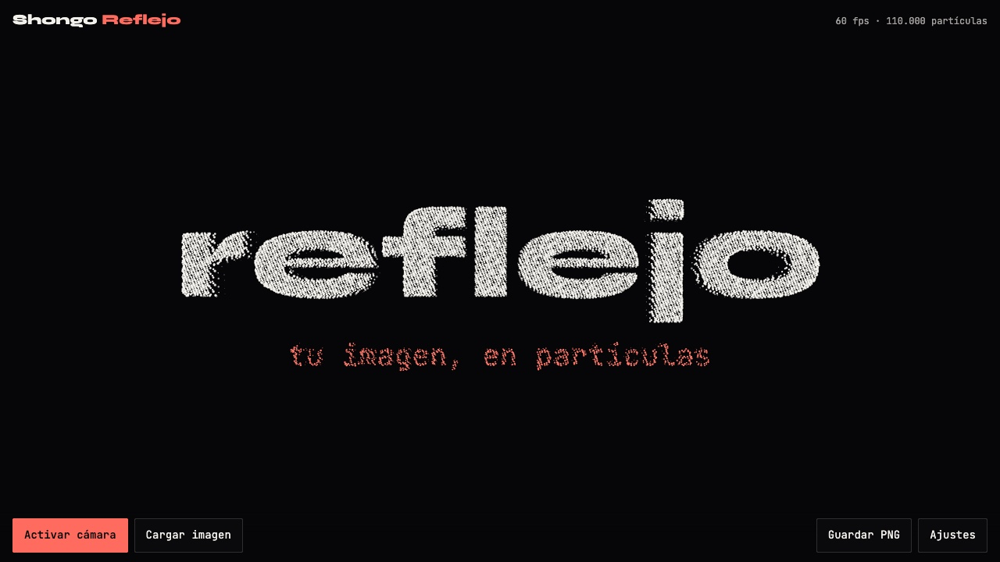

# Shongo · Reflejo

Tu cámara y tus imágenes convertidas en **una nube de hasta 500.000 partículas**, en tiempo real y sin que nada salga de tu dispositivo. Hecho con **Three.js + TypeScript + Vite**.

**🔗 Ver en vivo: [jhonedinson-shongo.github.io/shongo-reflejo](https://jhonedinson-shongo.github.io/shongo-reflejo/)**

[](https://github.com/JhonEdinson-Shongo/shongo-reflejo/actions/workflows/deploy.yml)


[](https://jhonedinson-shongo.github.io/shongo-reflejo/)

## Cómo se usa

Al abrir, las partículas se juntan para escribir **reflejo**. Desde ahí:

- **Activar cámara:** tu imagen en vivo, hecha de puntos. Lo que se mueve frente a la cámara sopla sus propias partículas. En el celular aparece **Cambiar cámara** para pasar a la trasera.
- **Cargar imagen:** elige una o varias (JPG, PNG, WebP), o **arrástralas** a la ventana. Cada una queda como miniatura para volver a ella; al cambiar, una imagen se disuelve en la siguiente.
- **Mueve el cursor:** la vista se inclina y el relieve se lee como profundidad.
- **Guardar PNG:** descarga lo que está en pantalla.
- **Ajustes:**

| Control | Qué hace |
|---|---|
| Densidad | Cuántas partículas se dibujan (10.000 a 500.000 en escritorio, hasta 200.000 en el celular). |
| Tamaño | Multiplica el tamaño de cada punto. |
| Relieve | Cuánto se adelantan los puntos claros: la imagen gana volumen. |
| Suavizado | Promedia los fotogramas de la cámara para quitar el parpadeo del ruido. |
| Dispersión | Qué tan lejos sale volando lo que se mueve. |

Arriba, un indicador muestra los fps y las partículas en pantalla.

### Qué tiene

- **Privado:** la cámara y las imágenes se procesan en el navegador. No hay servidor ni subida de archivos.
- **Una sola nube de puntos:** cada partícula tiene un lugar fijo en la imagen y el vertex shader lee el color directamente de la textura. Un fotograma nuevo cuesta una subida de textura, no recalcular puntos.
- **Sin cuadrícula:** los puntos siguen una secuencia de baja discrepancia (R2). Cualquier cantidad cubre la imagen de forma pareja, así que la densidad es solo cuántos se dibujan.
- **Filtro de cámara en la GPU:** cada fotograma se refleja, se promedia con los anteriores y guarda en el canal alfa un rastro del movimiento que se desvanece.
- **Transiciones como arena:** cada punto sale a su propio ritmo y gira a mitad de camino, así que una imagen se disuelve en la otra en vez de cortar.
- **Se adapta al equipo:** en pantallas pequeñas o con poca memoria arranca con menos partículas; el tamaño de los puntos se calcula según el espacio que tiene cada uno.
- **Accesible:** respeta `prefers-reduced-motion` (sin remolinos ni inclinación, transiciones cortas), controles con teclado, `aria-pressed` y mensajes de error claros cuando la cámara no está disponible.

## Arrancar

```bash
npm install     # solo la primera vez
npm run dev     # abre la URL que aparece (normalmente http://localhost:5173)
```

### Probar en el celular

El navegador solo da acceso a la cámara en `localhost` o por HTTPS. Para abrirla desde el celular en la misma red:

```bash
npm run dev:phone   # HTTPS con un certificado temporal, expuesto en la red local
```

Abre la URL `https://…` que aparece en la terminal y acepta el aviso del certificado.

## Estructura

| Archivo | Qué hace |
|---|---|
| `index.html` | La página: lienzo, barra de controles, panel de ajustes y avisos. |
| `src/main.ts` | Conecta la interfaz: cámara, carga y arrastre de imágenes, miniaturas, ajustes, captura PNG y el indicador de fps. |
| `src/engine/stage.ts` | `ParticleStage`: escena, nube de puntos, transición entre capas, filtro de la cámara e inclinación con el cursor. |
| `src/engine/shaders.ts` | Los shaders: el de las partículas (relieve, transición, dispersión) y el filtro de cada fotograma de la cámara. |
| `src/engine/sources.ts` | Las fuentes: el título inicial, las imágenes cargadas (respetando la rotación EXIF) y la cámara. |
| `src/styles/main.css` | El diseño de la interfaz. |

## Conceptos clave

1. **Capas A y B.** Todo lo que se muestra es una *capa* (una textura con su proporción). El shader recibe dos y `uMorph` va de 0 a 1 para pasar de una a la otra.
2. **El brillo es forma.** El tamaño y la opacidad de cada punto salen de la luminancia: lo oscuro de la imagen queda como espacio vacío y el relieve empuja hacia adelante lo claro.
3. **Ping-pong de render targets.** La cámara se filtra con dos texturas: cada fotograma lee una y escribe la otra. Se usan *half floats* para que el promedio no se quede corto con 8 bits.
4. **Movimiento en el alfa.** El filtro compara el fotograma con el anterior y guarda la diferencia en el canal alfa. El shader de partículas lo usa para lanzar los puntos.

## Publicar

Cada push a `main` compila el proyecto y lo publica en GitHub Pages con el workflow `.github/workflows/deploy.yml`. También se puede lanzar a mano desde la pestaña **Actions**.

- En GitHub, **Settings → Pages → Source** debe estar en **"GitHub Actions"**.
- `vite.config.ts` usa `base: './'`, así que el mismo build funciona en `usuario.github.io/repo/` y en un dominio propio.
- GitHub Pages sirve por HTTPS, que es lo que la cámara necesita.

Para probar el build en local:

```bash
npm run build     # revisa los tipos con tsc y genera dist/
npm run preview   # lo sirve tal como quedará publicado
```

## Créditos

- Tipografías: Syne y JetBrains Mono (licencia OFL), servidas desde el propio sitio con `@fontsource`.

---

Hecho por [Jhon Castañeda](https://jhoncastaneda.vercel.app/es) · [GitHub](https://github.com/JhonEdinson-Shongo) · [LinkedIn](https://www.linkedin.com/in/jhon-edinson-casta%C3%B1eda-oviedo-6a78311ab)
